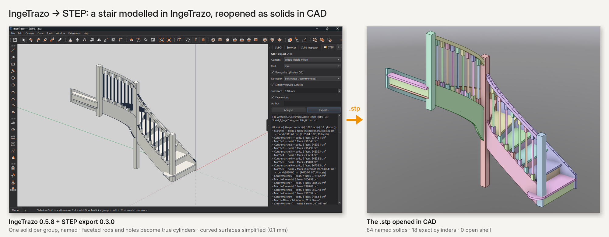

# STEP export — IngeTrazo extension

Clean-room STEP (ISO 10303-21, AP214) writer for [IngeTrazo](https://github.com/ingelibre/ingetrazo),
GPL-3.0-or-later. Pure Python + numpy, nothing to install. Answers the roadmap item
"STEP export, as an extension" (#532).

**Extensions ▸ Export to STEP…** opens the *STEP* panel (English / French, follows IngeTrazo's language):

- content: whole visible model, or selection only — one solid per group/component, named after it;
- unit (mm / cm / m), face colours, author;
- **Recognise cylinders**: faceted drill holes, rods, tubes, rounds and fillets become true
  `CYLINDRICAL_SURFACE` faces with `CIRCLE` edges (from IngeTrazo's soft edges, then from geometry
  for seams flatter than 20°);
- **Simplify curved surfaces** (optional, tolerance in mm): neighbouring facets within the tolerance
  of one plane are merged — finely sampled curves stop shading as hundreds of slivers. Only the
  file is simplified, never the model;
- **Analyse** shows the report without writing; **Export…** writes the `.stp`.

Before writing, each part is checked and lightly repaired: welded, oriented, stacked duplicate faces
and stray overlapping faces dropped, T-junctions stitched, small planar holes capped, warped faces
triangulated (strip faces rung by rung). Closed parts become `MANIFOLD_SOLID_BREP`; parts that still
cannot close are written as shells and listed in the report with the reason.

Checked by re-reading every test file with an independent reader (volumes against closed forms) and,
during development, with FreeCAD's kernel (OpenCascade): all solids valid.

Not covered yet: cones, spheres, tori; free-form NURBS surfaces.

## Install

Extension Manager (catalog), or unzip `dist/stepexport-<version>.zip` into
`%APPDATA%\ingetrazo\plugins` (you get `plugins\stepexport\__init__.py`).

## Tests

`python tests/test_step.py`, `python tests/test_cylinders.py`, `python tests/test_collect.py`
(pytest-compatible, synthetic geometry only).

## Extra tool

`tools/dxf_to_step.py` converts 3DFACE DXF files (one block per part) straight to STEP with the same
engine (needs `ezdxf`). Not part of the extension.
