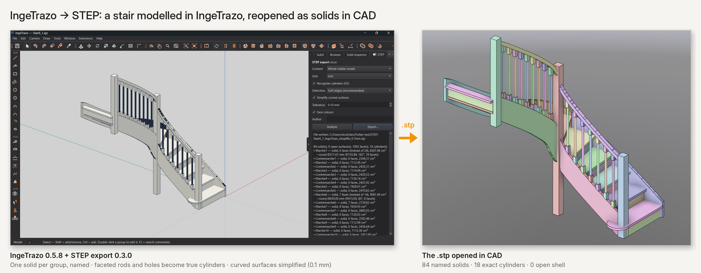
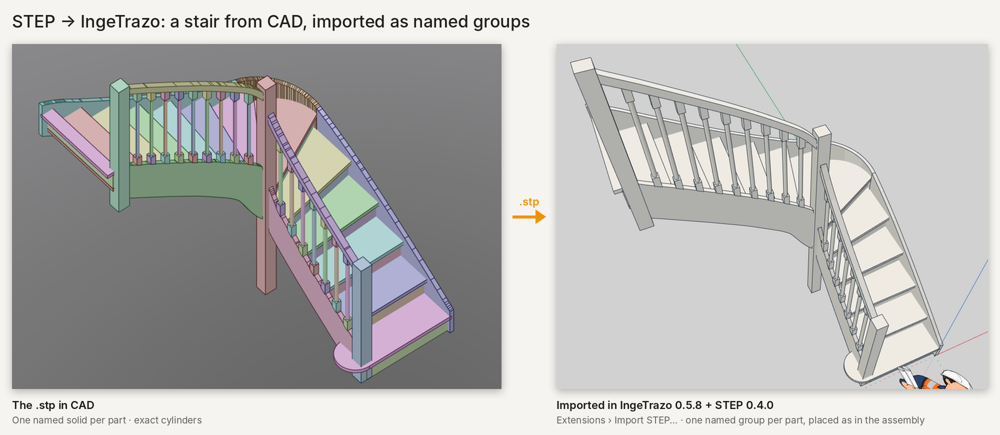
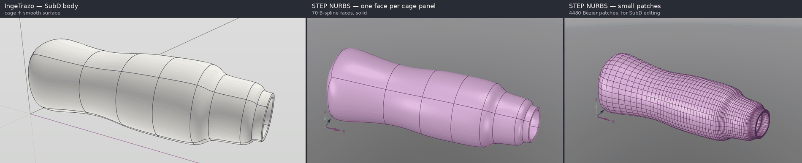

# STEP / IGES export and STEP import — IngeTrazo extension

Clean-room STEP (ISO 10303-21, AP214) writer for [IngeTrazo](https://github.com/ingelibre/ingetrazo),
GPL-3.0-or-later. Pure Python + numpy, nothing to install. Answers the roadmap item
"STEP export, as an extension" (#532).

**Extensions ▸ Export to STEP / IGES…** opens the *STEP* panel (English / French / Spanish, follows IngeTrazo's language):

- format: **STEP**, **IGES solids** or **IGES surfaces** (see *IGES* below);
- content: whole visible model, or selection only — one solid per group/component, named after it;
- unit: **Document** by default (the units set in IngeTrazo: metric as they are, inches for
  every inch form and for feet-and-inches, feet for decimal feet), or mm / cm / m / in / ft;
  face colours, author;
- **Recognise cylinders**: faceted drill holes, rods, tubes, rounds and fillets become true
  `CYLINDRICAL_SURFACE` faces with `CIRCLE` edges, or `ELLIPSE` edges where a plane cuts them at an
  angle (mitred tube corners, angled pipe ends) — from IngeTrazo's soft edges, then from geometry
  for seams flatter than 25°, so a rod in 15 or more facets is found;
- **Simplify curved surfaces** (optional, tolerance in mm): neighbouring facets within the tolerance
  of one plane are merged — finely sampled curves stop shading as hundreds of slivers. Only the
  file is simplified, never the model;
- **Analyse** shows the report without writing; **Export…** writes the `.stp`.
- **Convert a DXF to STEP / IGES…** reads a DXF directly in double precision (exact sizes, one solid
  per part, one named part per block) and writes the `.stp` (or `.igs`, following the format),
  without changing the open model.

Before writing, each part is checked and lightly repaired: welded, oriented, stacked duplicate faces
and stray overlapping faces dropped, T-junctions stitched, small planar holes capped, warped faces
triangulated (strip faces rung by rung). Closed parts become `MANIFOLD_SOLID_BREP`; parts that still
cannot close are written as shells and listed in the report with the reason.

Checked by re-reading every test file with an independent reader (volumes against closed forms) and,
during development, with FreeCAD's kernel (OpenCascade): all solids valid.

Export does not write cones, spheres, tori or free-form NURBS surfaces yet.

## SubD bodies as NURBS

Bodies made with the **SubD** extension (Catmull-Clark subdivision) are written as smooth
**B-spline surfaces** rebuilt from their control cage, not as facets (option *SubD bodies as
NURBS surfaces*, on by default, STEP only):

- **One per cage panel (light)**: one bicubic B-spline face per quad of the cage, the panels you
  modelled; few faces, easy in any CAD program. Knot spans are added until the faces are within
  0.1 mm of the SubD surface.
- **Small patches (for SubD editing)**: one bicubic Bézier patch per quad of the refined cage,
  the kind a CAD program's own subdivision tools edit.

On ordinary areas (four quads around each point, no crease) the export is exact; around
extraordinary points and creases the faces are fitted, and the report gives the largest distance
to the SubD surface. A closed cage gives a closed solid (faces share their edge curves), an open
one a surface. A body *finished* with SubD 1.4 or later (coming) keeps its cage and still exports as
NURBS, moved, turned or scaled; once its mesh is edited it is written as facets, and the report
says so. Checked with OpenCascade (valid solids, same volume as the subdivision surface) and in
a commercial CAD program.

*En français* : les corps **SubD** sortent en surfaces **NURBS** lisses reconstruites depuis leur
cage — une face par panneau de la cage (léger, pour tout logiciel de CAO) ou de petits carreaux
(pour retoucher en subdivision). Exact sur les zones régulières, à 0,1 mm près ailleurs ; un
corps terminé avec SubD 1.4 (à venir) garde sa cage et sort encore en NURBS tant que son maillage n'est pas
modifié.

## IGES

The same solids, cylinders and ellipses as the STEP, written to IGES 5.3 (`.igs`) from the public
specification (ingelibre/ingetrazo#109):

- **IGES solids** (default): each closed part is a manifold solid B-rep (entity 186: shell 514,
  faces 510, loops 508, edge list 504, vertex list 502) on plane (190) and cylinder (192)
  surfaces, edges as lines (110), circle arcs (100) and ellipse arcs (104). Open parts go out as
  trimmed surfaces;
- **IGES surfaces**: every face is a trimmed surface (144) bounded by model-space curves, the
  oldest form, for programs that do not read IGES solids; they sew the faces back into solids.

Each part is a named component (subfigure 308 placed by a 408), its solid or faces inside it;
names (406 form 15) and colours (314) travel with each part; units mm / cm / m / in / ft. Checked with
OpenCascade (FreeCAD's kernel): every solid valid, volumes equal to the closed-form ones and to the
STEP of the same model, names and colours read back (`tests/test_iges.py`).

## Import

**Extensions ▸ Import STEP…** (or the panel's **Import…** button, or simply opening a `.stp` /
`.step` file in IngeTrazo — double-click, Open Recent, command line) brings a STEP assembly
(AP203 / AP214 / AP242 B-rep) into the open model: **one group per part**, named after it and
painted with its colour, placed as in the assembly, **in one undo step**; the new groups are left
selected.

Names travel both ways: each exported part is a named component (product) under an
assembly named after the file, so SpaceClaim, FreeCAD, Fusion and the like show *Marche*,
not *Solide*; on import the component name wins over a solid's automatic name.

The reader (`stepexport/stepread.py`, pure Python, written from ISO 10303-21) reads the product
tree, placements, units and colours, and meshes planes, cylinders, cones, spheres, tori, linear
extrusions, revolutions and B-spline surfaces to a chord tolerance (0.2 mm); planar faces come in
whole with their holes, curved ones with smooth (soft) edges; closed parts stay watertight. Checked
against files written by an independent CAD kernel (OpenCascade, through CadQuery): volumes within
0.3 %, exact bounding boxes, placements of turned parts, colours — and against this extension's own
export (round trip). Not read yet: AP242 tessellated-only faces (reported).

The same reader ships in the Motion extension (mechanisms), so a GrabCAD model can be imported and
set in motion there too.

## Install

Extension Manager (catalog), or unzip `dist/stepexport-<version>.zip` into
`%APPDATA%\ingetrazo\plugins` (you get `plugins\stepexport\__init__.py`).

## Tests

`python tests/test_step.py`, `python tests/test_cylinders.py`, `python tests/test_collect.py`,
`python tests/test_stepread.py` (files from an independent kernel, `tests/data/`, regenerated by
`tools/make_step_fixtures.py` which needs CadQuery — a test-data tool only),
`python tests/test_roundtrip_import.py` (export then import),
`python tests/test_import_ingetrazo.py` (in a real IngeTrazo window; needs PySide6 and an
IngeTrazo checkout, `INGETRAZO_SRC`), `tests/test_iges.py` (read back with OpenCascade:
`pip install cadquery-ocp`, a test tool only; skipped without it). All pytest-compatible.

## Extra tool

`tools/dxf_to_step.py` converts 3DFACE DXF files (one block per part) straight to STEP with the same
engine (needs `ezdxf`). Not part of the extension.
