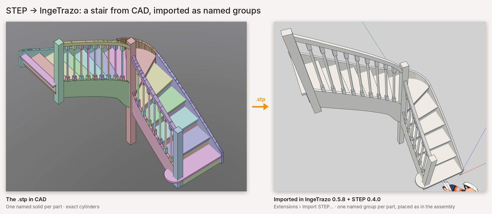

# STEP export and import — IngeTrazo extension

Clean-room STEP (ISO 10303-21, AP214) writer for [IngeTrazo](https://github.com/ingelibre/ingetrazo),
GPL-3.0-or-later. Pure Python + numpy, nothing to install. Answers the roadmap item
"STEP export, as an extension" (#532).

**Extensions ▸ Export to STEP…** opens the *STEP* panel (English / French, follows IngeTrazo's language):

- content: whole visible model, or selection only — one solid per group/component, named after it;
- unit (mm / cm / m), face colours, author;
- **Recognise cylinders**: faceted drill holes, rods, tubes, rounds and fillets become true
  `CYLINDRICAL_SURFACE` faces with `CIRCLE` edges, or `ELLIPSE` edges where a plane cuts them at an
  angle (mitred tube corners, angled pipe ends) — from IngeTrazo's soft edges, then from geometry
  for seams flatter than 20°;
- **Simplify curved surfaces** (optional, tolerance in mm): neighbouring facets within the tolerance
  of one plane are merged — finely sampled curves stop shading as hundreds of slivers. Only the
  file is simplified, never the model;
- **Analyse** shows the report without writing; **Export…** writes the `.stp`.

Before writing, each part is checked and lightly repaired: welded, oriented, stacked duplicate faces
and stray overlapping faces dropped, T-junctions stitched, small planar holes capped, warped faces
triangulated (strip faces rung by rung). Closed parts become `MANIFOLD_SOLID_BREP`; parts that still
cannot close are written as shells and listed in the report with the reason.

Checked by re-reading every test file with an independent reader (volumes against closed forms) and,
during development, with FreeCAD's kernel (OpenCascade): all solids valid.

Export does not write cones, spheres, tori or free-form NURBS surfaces yet.

## Import

**Extensions ▸ Import STEP…** (or the panel's **Import…** button, or simply opening a `.stp` /
`.step` file in IngeTrazo — double-click, Open Recent, command line) brings a STEP assembly
(AP203 / AP214 / AP242 B-rep) into the open model: **one group per part**, named after it and
painted with its colour, placed as in the assembly, **in one undo step**; the new groups are left
selected.

Names travel both ways: each exported part is a named component (product) under an
assembly named after the file, so SpaceClaim, FreeCAD, Fusion and the like show *Marche*,
not *Solide*; on import the component name wins over a solid's automatic name.

The reader (`stepexport/stepread.py`, pure Python, written from ISO 10303-21) reads the product
tree, placements, units and colours, and meshes planes, cylinders, cones, spheres, tori, linear
extrusions, revolutions and B-spline surfaces to a chord tolerance (0.2 mm); planar faces come in
whole with their holes, curved ones with smooth (soft) edges; closed parts stay watertight. Checked
against files written by an independent CAD kernel (OpenCascade, through CadQuery): volumes within
0.3 %, exact bounding boxes, placements of turned parts, colours — and against this extension's own
export (round trip). Not read yet: AP242 tessellated-only faces (reported).

The same reader ships in the Motion extension (mechanisms), so a GrabCAD model can be imported and
set in motion there too.

## Install

Extension Manager (catalog), or unzip `dist/stepexport-<version>.zip` into
`%APPDATA%\ingetrazo\plugins` (you get `plugins\stepexport\__init__.py`).

## Tests

`python tests/test_step.py`, `python tests/test_cylinders.py`, `python tests/test_collect.py`,
`python tests/test_stepread.py` (files from an independent kernel, `tests/data/`, regenerated by
`tools/make_step_fixtures.py` which needs CadQuery — a test-data tool only),
`python tests/test_roundtrip_import.py` (export then import),
`python tests/test_import_ingetrazo.py` (in a real IngeTrazo window; needs PySide6 and an
IngeTrazo checkout, `INGETRAZO_SRC`). All pytest-compatible.

## Extra tool

`tools/dxf_to_step.py` converts 3DFACE DXF files (one block per part) straight to STEP with the same
engine (needs `ezdxf`). Not part of the extension.
